# 🪙 Penny Pilot

[](LICENSE)
[](https://reactnative.dev)
[](https://expo.dev)
[](https://fastapi.tiangolo.com)
[](https://www.python.org)
[](https://www.typescriptlang.org)
[](https://www.nativewind.dev)
[](docs/evidence/ui/step2/contrast.txt)
[](#-zero-arithmetic-rule)

**Penny Pilot** is an automated micro-savings, intelligent budgeting, and financial literacy platform tailored specifically for college students.

By transforming loose digital change from everyday transactions into purpose-driven savings, Penny Pilot helps students painlessly achieve financial milestones. It couples deterministic financial math with an on-device, privacy-preserving AI financial coach (**LLaMA 3 via Ollama**) to explain spending patterns, flag recurring subscription leakages, and instill lifelong financial discipline.

---

## 📑 Table of Contents

- [What the Project Does](#-what-the-project-does)
- [Why Penny Pilot](#-why-penny-pilot)
- [Visual Feature Tour](#-visual-feature-tour)
- [System Architecture](#-system-architecture)
- [How Users Can Get Started](#-how-users-can-get-started)
  - [Prerequisites](#prerequisites)
  - [Local Development Setup](#local-development-setup)
  - [Docker Production Deployment](#docker-production-deployment)
  - [Environment Variables](#environment-variables)
- [Engineering Standards & Compliance](#-engineering-standards--compliance)
  - [Zero-Arithmetic Rule](#zero-arithmetic-rule)
  - [Single Currency Standard (INR ₹)](#single-currency-standard-inr-)
  - [WCAG 2.1 AA Color Contrast](#wcag-21-aa-color-contrast)
- [Repository Structure](#-repository-structure)
- [Where Users Can Get Help](#-where-users-can-get-help)
- [Maintainers & Contributing](#-maintainers--contributing)

---

## 🎯 What the Project Does

For many college students, managing personal finances is intimidating, opaque, and stressful. Most budgeting apps rely on tedious manual categorization, sell user transaction histories to data brokers, or present discouraging debt graphs that heighten financial anxiety.

**Penny Pilot bridges this gap through an empathetic, student-centric platform:**

- **Automated Round-Up Engine**: Automatically calculates spare change on debit/UPI transactions to the nearest ₹10, ₹50, or ₹100 and channels the difference directly into targeted savings goals.
- **Bank Statement Import & Spending Analysis**: Upload a bank statement CSV (HDFC/ICICI/SBI-style columns work as-is; see `docs/samples/bank_statement_sample.csv`). Categories are inferred from narrations, and Penny Pilot shows your typical month, where it goes, repeating charges, suggested budgets and what round-ups would have saved.
- **Bank Sandbox**: No real bank is connected. "Simulate a payment" creates the next transaction a bank feed might deliver, modelled on your own imported history, and runs it through round-ups and budget alerts (labelled *Simulated*).
- **Deterministic Progress Tracking**: Goals, balances, and savings forecasts are calculated securely by the backend engine, preventing confusing rounding discrepancies on client devices.
- **Private AI Financial Coach**: Students converse with an empathetic, local AI coach that offers clear, non-judgmental guidance and personalized spending insights grounded in your own transactions, goals and budgets.
- **Impulse Spending Monitor**: Replaces guilt-inducing metrics with actionable behavioral nudges that identify emotional spending triggers before budgets break.
- **Emergency Vault Protection**: Locks emergency cushions with multi-step confirmation modals to protect rainy-day funds from casual withdrawal.

---

## 💡 Why Penny Pilot

| Feature | Legacy Financial Apps | Penny Pilot Advantage |
| :--- | :--- | :--- |
| **Privacy & Data Safety** | Transaction data sold to marketing brokers; cloud AI APIs inspect financial records | **Local AI inference (Ollama LLaMA-3)**; zero third-party data transmission |
| **Savings Automation** | Requires manual transfers or high minimum deposits | **Micro-savings round-ups** starting from ₹1 of spare change |
| **Calculation Accuracy** | Client apps calculate math locally, leading to sync drifts and rounding errors | **Strict Zero-Arithmetic Rule**: Backend is the single source of truth |
| **Behavioral Tone** | Fear-based "Regret Meters" and warning banners | **Constructive Impulse Monitor** with empathetic, warm nudges |
| **Currency Consistency** | Mixed USD/EUR/INR symbols and inconsistent commas | **100% Indian Rupee (INR `₹`)** standard with `en-IN` formatting |
| **Accessibility (a11y)** | Low-contrast grey-on-grey text, undersized tap targets | **WCAG 2.1 AA certified** (all text ≥ 4.5:1), 44pt minimum tap targets |

---

## 📸 Visual Feature Tour

### 1. Student Dashboard & Design System Evolution
Penny Pilot features a custom **Warm Cream & Forest Green** design system (`#fbf7ee` canvas, `#ffffff` card surface, `#144a32` forest green primary) built to alleviate student financial stress.

| Modern Student Dashboard | Design Evolution (Before vs After) |
| :---: | :---: |
| 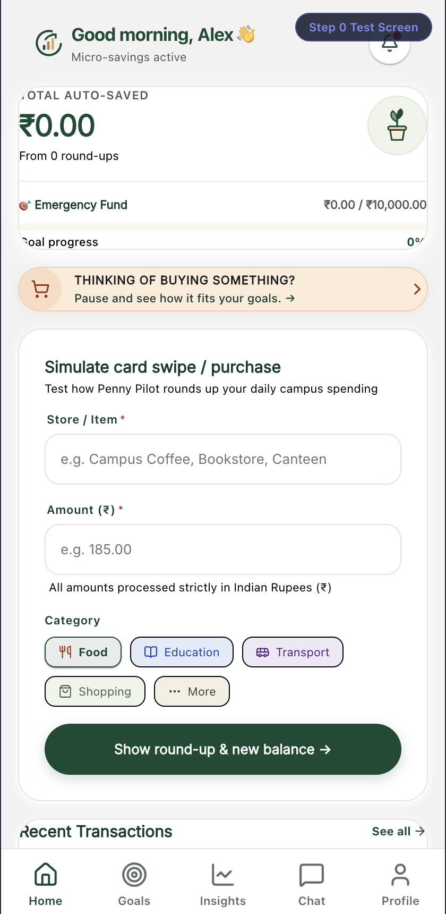 | 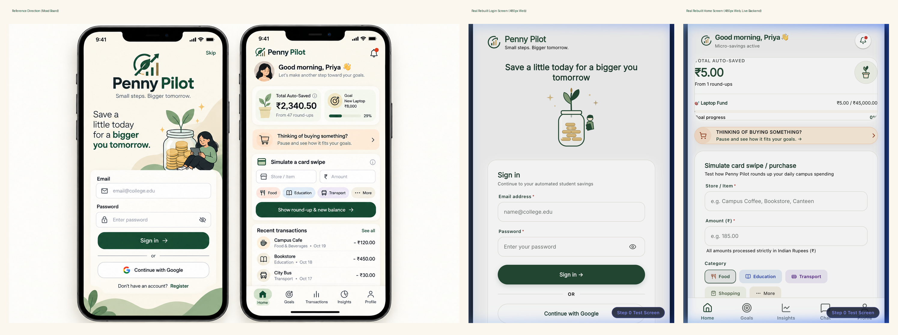 |
| *Net savings card, active goals progress, recent transactions, and quick action pills.* | *Transition from cold, generic blue to calming, accessible warm cream and forest green.* |

---

### 2. Accessible Authentication & Student Registration
Clean, accessible authentication supporting email/password and Google OAuth, with frictionless account creation tailored for student savers.

| Warm Cream Authentication | Seamless Student Registration |
| :---: | :---: |
| 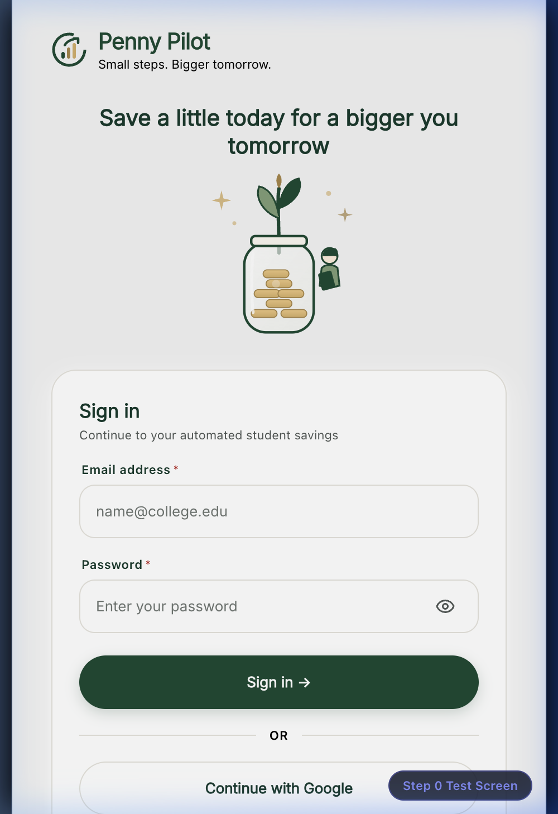 | 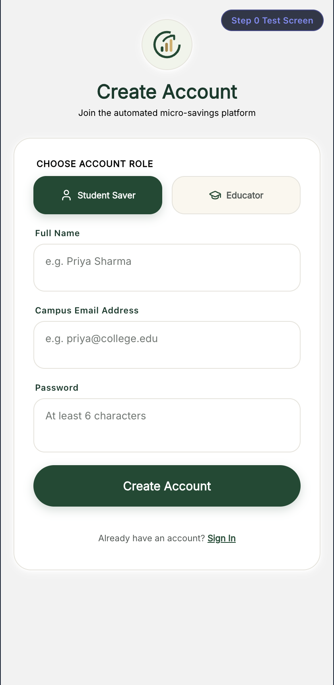 |
| *High-contrast inputs with 44pt tap targets and seamless OAuth options.* | *Accessible onboarding with student validation, instant account creation, and password safeguards.* |

---

### 3. Guided Student Onboarding & Budget Boundaries
Personalized onboarding guides students to set sustainable baselines, paired with intelligent budget categories that establish safe monthly spending boundaries.

| Interactive Onboarding Flow | Intelligent Budget Boundaries |
| :---: | :---: |
| 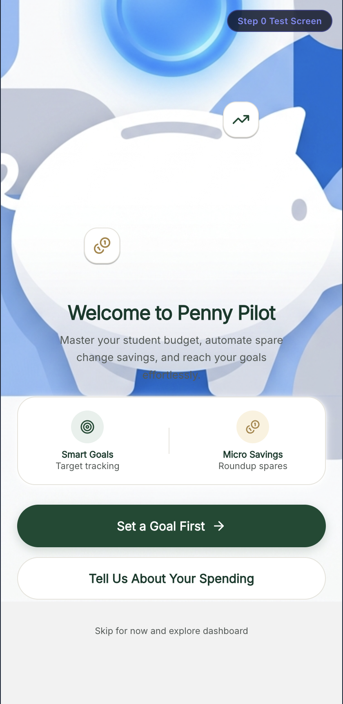 | 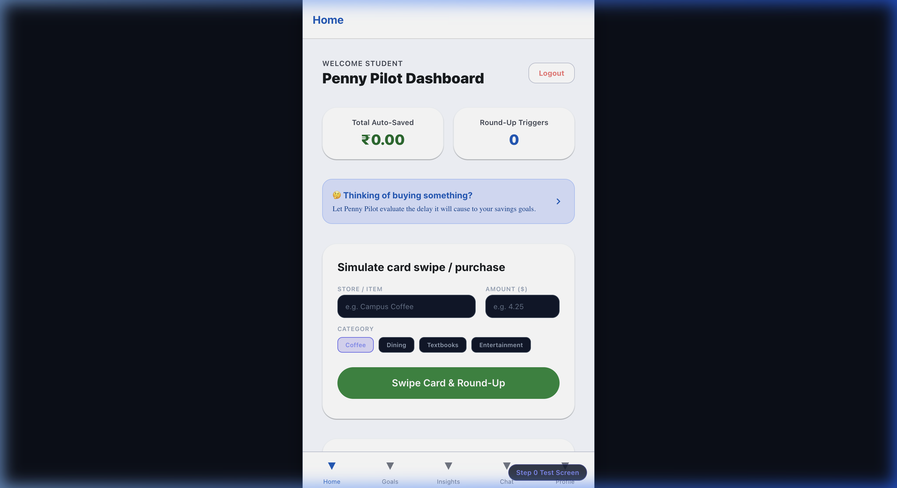 |
| *Step-by-step guidance to set up initial allowance, recurring bills, and savings targets.* | *Category spending limits with real-time remaining balance and visual boundary alerts.* |

---

### 4. Purpose-Driven Goals & Impulse Monitor
Students save for what matters most—laptop upgrades, semester travel, emergency cushions—with real-time progress percentages computed deterministically by the backend.

| Smart Goals Dashboard | Impulse Monitor & Insights |
| :---: | :---: |
| 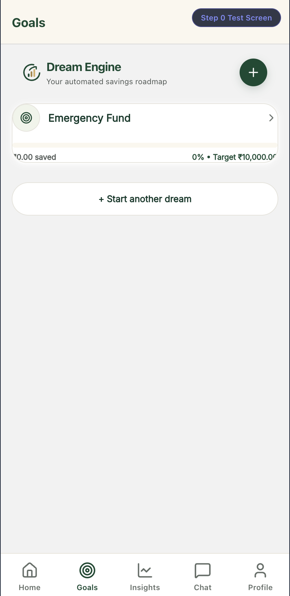 | 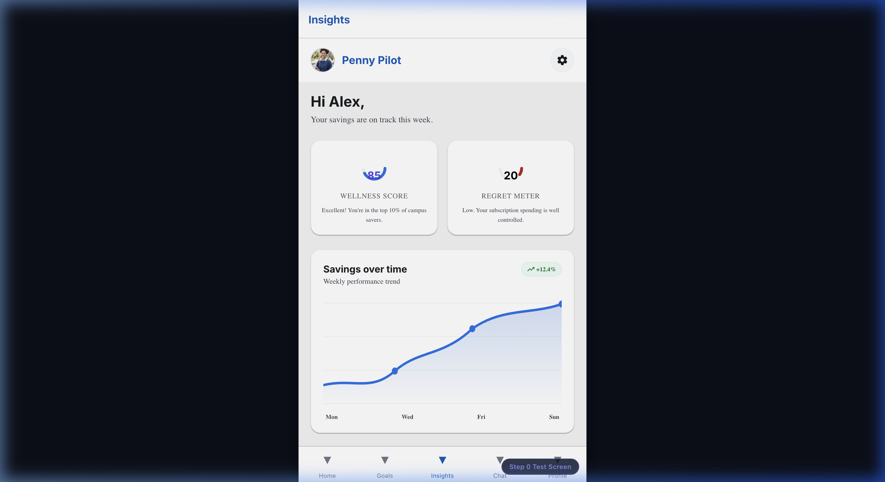 |
| *Live backend progress percentages, completion forecasts, and goal editing.* | *Personalized financial health score and impulse-spending alert monitors.* |

---

### 5. Private AI Financial Coach & Subscription Negotiator
A conversational AI partner powered by on-device LLaMA 3 provides contextual financial literacy without sending student banking details to proprietary external cloud services.

| AI Financial Coach Chat | Subscription Negotiator |
| :---: | :---: |
| 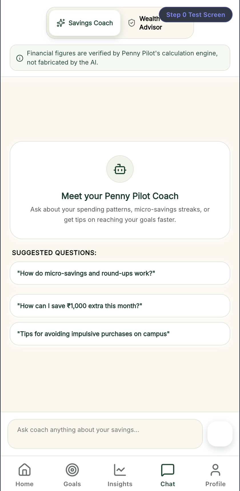 | 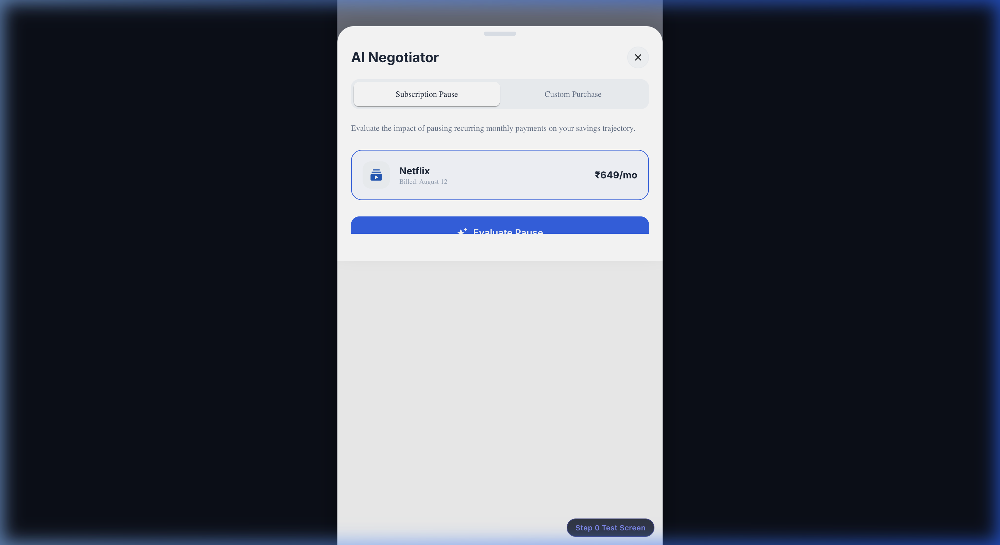 |
| *Conversational advice with prompt disclaimer banners and quick suggestion chips.* | *Subscriptions detected from your own transactions, with the effect of pausing them on your goal date.* |

---

### 6. Automated Round-Up Tracker & Emergency Vault
Automate micro-savings on every transaction and protect reserves from accidental spending.

| Transaction Round-Up Tracker | Emergency Vault Guard |
| :---: | :---: |
|  | 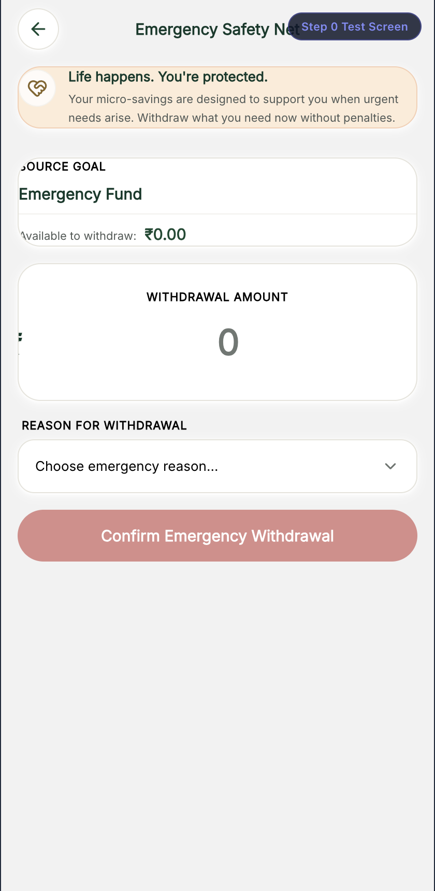 |
| *Visual log of round-up spare change accumulated across debits.* | *Compassionate rainy-day fund protection featuring multi-step confirmation modals.* |

---

### 7. Warm Cream Design System Tokens & Typography Scale
A soothing visual palette, typography scale, and accessible spacing tokens built specifically to reduce student financial anxiety.

<p align="center">
  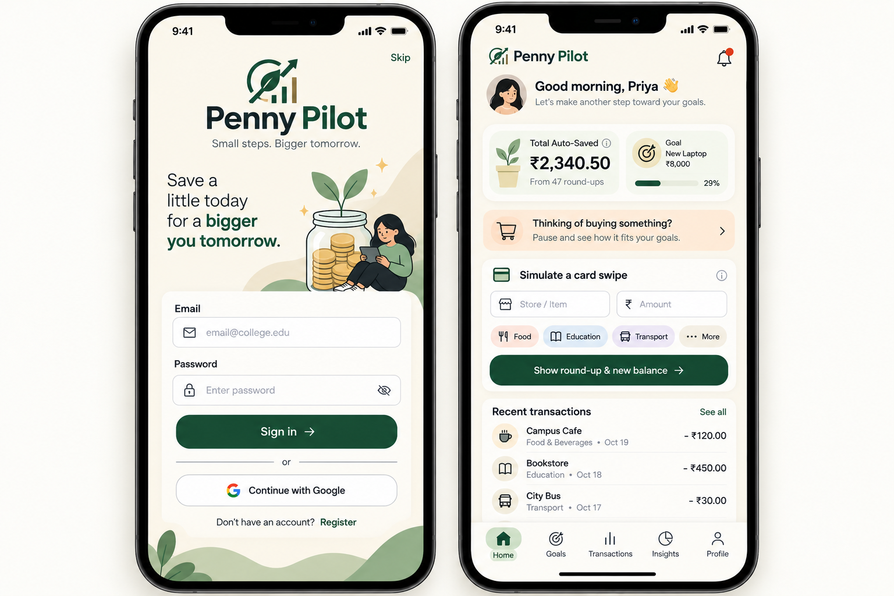
</p>
<p align="center">
  <em>Curated warm palette (#fbf7ee, #144a32, #a88544), Inter typography hierarchy, and WCAG AA contrast tokens.</em>
</p>

---

## 🏗️ System Architecture

```
                      ┌────────────────────────────────────────┐
                      │        React Native / Expo Client      │
                      │  (iOS, Android, Web - Port 8081)       │
                      │  • NativeWind v4 (Tailwind CSS)        │
                      │  • Inter Font Family                   │
                      │  • Zero-Arithmetic UI Layer            │
                      └───────────────────┬────────────────────┘
                                          │ REST / JSON (JWT Auth)
                                          ▼
                      ┌────────────────────────────────────────┐
                      │            FastAPI Backend             │
                      │  (Python 3.11+, Uvicorn - Port 8000)   │
                      │  • Business Logic & Rule Engine        │
                      │  • Deterministic Calculation Service   │
                      │  • Alembic Database Migrations         │
                      └───────────┬────────────────┬───────────┘
                                  │                │
                   SQLAlchemy ORM │                │ Local HTTP (Ollama API)
                                  ▼                ▼
        ┌───────────────────────────────┐    ┌──────────────────────────────┐
        │       Relational Database     │    │       Local AI Engine        │
        │  • SQLite (Local Development) │    │  • Ollama (LLaMA 3 8B)       │
        │  • PostgreSQL 15 (Docker)     │    │  • Zero-Cloud Data Leakage   │
        └───────────────────────────────┘    └──────────────────────────────┘
```

---

## 🚀 How Users Can Get Started

### Prerequisites

Ensure you have the following installed on your development machine:
- **Node.js**: `v18.0.0` or higher ([Download Node.js](https://nodejs.org))
- **Python**: `3.11` or higher ([Download Python](https://www.python.org))
- **Git**: `2.30+`
- **Docker & Docker Compose** *(optional, for containerized deployment)*
- **Ollama** *(optional, for local AI chat)*: ([Download Ollama](https://ollama.com))

---

### Local Development Setup

#### 1. Clone the Repository
```bash
git clone https://github.com/NitikasriJeyanAchary0109/ConsumerLiterarcyTrack.git
cd ConsumerLiterarcyTrack
```

#### 2. Backend Setup (FastAPI)
```bash
# Navigate to the backend directory
cd backend

# Create and activate a Python virtual environment
python3 -m venv venv
source venv/bin/activate       # On Windows: venv\Scripts\activate

# Install dependencies
pip install -r requirements.txt

# Configure your environment
cp .env.example .env

# Run database migrations
alembic upgrade head

# Start the FastAPI server with live reload
uvicorn app.main:app --reload --host 0.0.0.0 --port 8000
```
- API will be accessible at: `http://localhost:8000`
- Interactive Swagger docs at: `http://localhost:8000/docs`
- Health check endpoint: `http://localhost:8000/health`

#### 3. Frontend Setup (Expo / React Native)
```bash
# Open a new terminal and navigate to frontend
cd frontend

# Install dependencies
npm install

# Verify TypeScript types
npm run ts:check

# Start the Expo development server
npm run start
```
- Press `w` in your terminal to open the web application at `http://localhost:8081`.
- Scan the QR code using the **Expo Go** app on your physical iOS or Android device.

#### 4. Local AI Engine Setup (Ollama)
To enable the offline AI financial coach:
```bash
# Install and run Ollama, then pull LLaMA 3
ollama pull llama3

# Verify Ollama is listening
curl http://localhost:11434/api/generate
```
*Note: If Ollama is not running, AI features (coach, money-basics Q&A, purchase advice, goal narration) return a clear "temporarily unavailable" message — nothing is made up. Deterministic features (round-ups, budgets, scores, forecasts dates) keep working, and the round-up explanation and wellness summary fall back to plain factual sentences built from your real figures.*

---

### Docker Production Deployment

To run the complete production stack (FastAPI + PostgreSQL + Caddy HTTPS Reverse Proxy + Ollama):

```bash
# Build and spin up all services
docker compose up --build -d

# Download LLaMA 3 weights inside the running container
docker exec -it ollama_ai ollama pull llama3

# Check container status
docker compose ps
```

---

### Environment Variables

Configure these settings in your `backend/.env` file:

| Variable | Default Value | Description |
| :--- | :--- | :--- |
| `DATABASE_URL` | `sqlite:///./campus_drift.db` | Database connection string (SQLite or PostgreSQL) |
| `JWT_SECRET` | `dev_secret_key` | Secret key for signing access tokens. **Required and must be a unique random string of ≥ 32 chars when `ENVIRONMENT=production`** (the API refuses to start otherwise; `docker compose` reads it from `.env`) |
| `JWT_ALGORITHM` | `HS256` | JWT signing algorithm |
| `ACCESS_TOKEN_EXPIRE_MINUTES` | `10080` (7 days) | Token expiration duration |
| `OLLAMA_URL` | `http://localhost:11434/api/generate` | Local Ollama AI inference endpoint |
| `ENVIRONMENT` | `development` | Runtime mode (`development` or `production`) |
| `GOOGLE_CLIENT_ID` | `your_google_client_id` | OAuth 2.0 Client ID for Google login |
| `GOOGLE_CLIENT_SECRET` | `your_google_client_secret` | OAuth 2.0 Client Secret for Google login |

Frontend environment (`frontend/.env`):
```bash
EXPO_PUBLIC_API_URL=http://localhost:8000
```

---

## 🛡️ Engineering Standards & Compliance

### Zero-Arithmetic Rule
To eliminate calculation drifts between platforms, the frontend code strictly adheres to the **Zero-Arithmetic Rule**:
- **0 client-side financial calculations**: The frontend never calculates `target - saved`, `saved / target * 100`, or `amount % 10`.
- Every percentage bar, remaining balance, and savings summary is calculated deterministically on the backend via SQLAlchemy and Pydantic schemas.
- Verified by continuous integration regression tests.

### Single Currency Standard (INR ₹)
- All monetary displays use the Indian Rupee standard symbol (`₹`) formatted with `Intl.NumberFormat('en-IN')`.
- Zero raw dollar (`$`) or foreign currency symbols appear in active student screens.

### WCAG 2.1 AA Color Contrast
Every visual color token is validated against the Web Content Accessibility Guidelines:

```
Color Pair / Use Case                            | Ratio   | Status
------------------------------------------------------------------
Body text primary (#0d3a2b) on cream (#fbf7ee)   | 11.85:1 | PASS (AA >= 4.5:1)
Secondary text (#525956) on cream (#fbf7ee)      |  6.72:1 | PASS (AA >= 4.5:1)
Muted caption (#666e69) on cream (#fbf7ee)       |  4.91:1 | PASS (AA >= 4.5:1)
White inputs placeholder (#707773) on white      |  4.59:1 | PASS (AA >= 4.5:1)
Gold UI icon accent (#a88544) on cream           |  3.22:1 | PASS (AA >= 3.0:1)
Gold text / links (#856529) on cream             |  5.05:1 | PASS (AA >= 4.5:1)
Forest green button (#144a32) with white text    | 10.22:1 | PASS (AA >= 4.5:1)
```

Run the contrast verification script anytime:
```bash
python3 docs/evidence/ui/step2/scripts/generate_contrast_report.py
```

---

## 📂 Repository Structure

```
ConsumerLiterarcyTrack/
├── backend/
│   ├── alembic/                # Database schema migrations
│   ├── app/
│   │   ├── main.py             # FastAPI application entrypoint & middleware
│   │   ├── database.py         # SQLAlchemy engine & session dependency
│   │   ├── models/             # Database models (User, Goal, Transaction, etc.)
│   │   ├── routers/            # API endpoints (goals, auth, savings, roundups, ai)
│   │   ├── schemas/            # Pydantic request/response validation schemas
│   │   └── services/           # Deterministic business rules & AI engine
│   ├── requirements.txt        # Backend dependencies
│   └── tests/                  # Pytest test suites (zero-arithmetic, security)
├── frontend/
│   ├── App.tsx                 # Root mobile/web application wrapper
│   ├── src/
│   │   ├── components/ui/      # Warm cream accessible UI components (Button, Card, Input, ScreenContainer, etc.)
│   │   ├── context/            # AuthContext and state providers
│   │   ├── navigation/         # Tab and Stack navigators (Student & Onboarding)
│   │   ├── screens/
│   │   │   ├── auth/           # LoginScreen, RegisterScreen
│   │   │   ├── onboarding/     # CSVUploadScreen (bank statement parser)
│   │   │   └── student/        # Core student tabs (HomeScreen, GoalsScreen, ChatScreen, BudgetsScreen)
│   │   │                       # Action screens (RoundupTracker, SubscriptionNegotiator, EmergencyWithdrawal)
│   │   │                       # Guided onboarding flow (OnboardingSetup, SpendingEntryChoice, ManualIncomeExpense, CreateGoal)
│   │   └── services/           # Typed Axios API client
│   ├── tailwind.config.js      # Design tokens (warm cream, forest green, accessible gold)
│   └── package.json            # Expo dependencies & scripts
├── docs/
│   ├── screenshots/            # Feature screenshots embedded in README
│   ├── evidence/               # Step audits, contrast reports, and reproduction scripts
│   └── ux/                     # UX audit specifications and design guidelines
├── docker-compose.yml          # Containerized production stack
├── Caddyfile                   # Automatic HTTPS reverse proxy config
└── README.md                   # Project documentation
```

---

## 🆘 Where Users Can Get Help

- **Documentation**: Explore comprehensive architecture and design specs in [`docs/ux/audit.md`](docs/ux/audit.md).
- **Interactive API Docs**: Once the backend is running, visit `http://localhost:8000/docs` for interactive OpenAPI Swagger exploration.
- **Reporting Bugs & Feature Requests**: Open an issue on our [GitHub Issues Tracker](https://github.com/NitikasriJeyanAchary0109/ConsumerLiterarcyTrack/issues).
- **Discussions**: Join our community conversations on [GitHub Discussions](https://github.com/NitikasriJeyanAchary0109/ConsumerLiterarcyTrack/discussions).

---

## 👥 Maintainers & Contributing

Penny Pilot is actively maintained by **Nitikasri Jeyan Achary** and the open source community.

We welcome contributions from developers, designers, and students! To contribute:
1. Fork the repository.
2. Create a feature branch: `git checkout -b feat/your-feature-name`.
3. Adhere to the **Zero-Arithmetic Rule** and run type checks: `npm run ts:check`.
4. Commit using [Conventional Commits](https://www.conventionalcommits.org) (e.g. `feat(goals): add goal deadline notification`).
5. Open a Pull Request against `main`.

---

<p align="center">
  Built with ❤️ for student financial empowerment.
</p>
