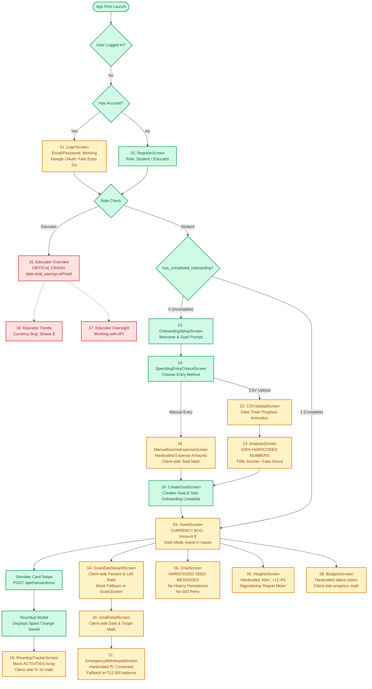

# Penny Pilot: Comprehensive UX Audit & Design Specification
**Branch**: `ui-production` | **Stage**: STEP 1 UX Audit & Technical Specification  
**Scope**: `docs/ux/`, `docs/evidence/ui/`, `frontend/`  
**Reference Document**: [mock_data_inventory.md](file:///Users/nitikasri/ConsumerLiterarcyTrack-1/.worktrees/ui-production/docs/ux/mock_data_inventory.md)

---

## 1. Executive Summary & Design Foundations

Penny Pilot is a financial literacy and automated micro-savings companion engineered specifically for university students. University life is characterized by irregular income (allowances, gigs, stipends), high peer pressure to spend, and anxiety surrounding financial decisions. 

This UX audit assesses the current state of every reachable and unreachable screen across the React Native (Expo / NativeWind v4) codebase. It evaluates information hierarchy, accessibility (WCAG AA), tap targets (44pt minimum), loading/empty/error states, copywriting empathy, and architectural compliance with the **Zero-Arithmetic Rule** and **Single Currency Policy (INR ₹)**.

### Architectural Ground Rules Followed
1. **Zero-Arithmetic Rule**: The frontend **never** calculates financial balances, savings projections, percentages, or aggregates client-side. Every financial number must originate from verified backend endpoints (`rule_engine.py`, `ai_engine.py`, or database models).
2. **Single Currency Policy**: Exactly one currency across the entire application: **INR (₹)**, formatted strictly via `Intl.NumberFormat('en-IN')`. Dollar signs (`$`) and unformatted decimal strings are strictly prohibited.
3. **No Fake / Hardcoded Data**: Remove hardcoded figures (e.g. `₹1,245`, `₹14,200`, `₹50,000`). Display real API responses or structured empty/loading states.
4. **Tokenized Design System**: Eradicate ad-hoc inline styles, hardcoded hex values (e.g., `#005bbf`, `#f7f9ff`), and legacy font family names (`PlusJakartaSans`, `WorkSans`) in favor of centralized NativeWind design tokens and `Inter` typography.

---

## 2. Screen Reachability & Screenshot Evidence Catalog

Before-screenshots of all reachable screens were captured at phone viewport dimensions (480px centered mobile layout) and archived in `docs/evidence/ui/before/`.

| ID | Screen Component | Route / Access Path | Reachable? | Evidence Screenshot Path | Status / Notes |
| :--- | :--- | :--- | :---: | :--- | :--- |
| **00** | `TestStyleScreen` | Dev floating badge (`__DEV__`) | Yes | [00_test_style_screen.png](file:///Users/nitikasri/ConsumerLiterarcyTrack-1/.worktrees/ui-production/docs/evidence/ui/before/00_test_style_screen.png) | Gated to development; verifies NativeWind v4 & Inter. |
| **01** | `LoginScreen` | Root Stack (`/login`) | Yes | [01_login.png](file:///Users/nitikasri/ConsumerLiterarcyTrack-1/.worktrees/ui-production/docs/evidence/ui/before/01_login.png) | Auth entry; Google OAuth & email/password fields. |
| **02** | `RegisterScreen` | Root Stack (`/register`) | Yes | [02_register.png](file:///Users/nitikasri/ConsumerLiterarcyTrack-1/.worktrees/ui-production/docs/evidence/ui/before/02_register.png) | Role toggle (Student/Educator), name, email, password. |
| **03** | `HomeScreen` | Student Tab 1 (`Home`) | Yes | [03_student_home.png](file:///Users/nitikasri/ConsumerLiterarcyTrack-1/.worktrees/ui-production/docs/evidence/ui/before/03_student_home.png) | Primary dashboard; card swipe simulation, round-up card. |
| **04** | `GoalsDashboardScreen` | Student Tab 2 (`Goals`) | Yes | [04_student_goals.png](file:///Users/nitikasri/ConsumerLiterarcyTrack-1/.worktrees/ui-production/docs/evidence/ui/before/04_student_goals.png) | "Dream Engine" savings goals list and progress bars. |
| **05** | `InsightsScreen` | Student Tab 3 (`Insights`) | Yes | [05_student_insights.png](file:///Users/nitikasri/ConsumerLiterarcyTrack-1/.worktrees/ui-production/docs/evidence/ui/before/05_student_insights.png) | Wellness Score, Regret Meter, and Spending Trends. |
| **06** | `ChatScreen` | Student Tab 4 (`AI Chat`) | Yes | [06_student_chat.png](file:///Users/nitikasri/ConsumerLiterarcyTrack-1/.worktrees/ui-production/docs/evidence/ui/before/06_student_chat.png) | Dual mode: AI Financial Coach & Investment Advisor. |
| **07** | `ProfileScreen` | Student Tab 5 (`Profile`) | Yes | [07_student_profile.png](file:///Users/nitikasri/ConsumerLiterarcyTrack-1/.worktrees/ui-production/docs/evidence/ui/before/07_student_profile.png) | Account settings, sub-navigation, logout action. |
| **08** | `GoalsScreen` | Standalone / Alternate Goals | Yes | [08_student_goals.png](file:///Users/nitikasri/ConsumerLiterarcyTrack-1/.worktrees/ui-production/docs/evidence/ui/before/08_student_goals.png) | Rich goal card view with priority badges. |
| **09** | `BudgetsScreen` | Profile -> Budgets & Limits | Yes | [09_student_budgets.png](file:///Users/nitikasri/ConsumerLiterarcyTrack-1/.worktrees/ui-production/docs/evidence/ui/before/09_student_budgets.png) | Category spend limits, progress bars, create/edit modal. |
| **10** | `RoundupTrackerScreen` | Home -> Roundup Tracker | Yes | [10_student_roundup_tracker.png](file:///Users/nitikasri/ConsumerLiterarcyTrack-1/.worktrees/ui-production/docs/evidence/ui/before/10_student_roundup_tracker.png) | Round-up accumulation summary & recent transactions. |
| **11** | `SubscriptionNegotiatorScreen` | Home -> Negotiator / Insights | Yes | [11_student_subscription_negotiator.png](file:///Users/nitikasri/ConsumerLiterarcyTrack-1/.worktrees/ui-production/docs/evidence/ui/before/11_student_subscription_negotiator.png) | AI purchase delay evaluator and pausable subscriptions. |
| **12** | `EmergencyWithdrawalScreen` | Goal Detail -> Withdraw | Yes | [12_student_emergency_withdrawal.png](file:///Users/nitikasri/ConsumerLiterarcyTrack-1/.worktrees/ui-production/docs/evidence/ui/before/12_student_emergency_withdrawal.png) | Goal liquidation flow with reason verification. |
| **13** | `OnboardingSetupScreen` | First Launch (`has_completed_onboarding: 0`) | Yes | [13_onboarding_setup.png](file:///Users/nitikasri/ConsumerLiterarcyTrack-1/.worktrees/ui-production/docs/evidence/ui/before/13_onboarding_setup.png) | Welcome screen with onboarding path choices. |
| **14** | `SpendingEntryChoiceScreen` | Onboarding Step 2 | Yes | [14_onboarding_spending_choice.png](file:///Users/nitikasri/ConsumerLiterarcyTrack-1/.worktrees/ui-production/docs/evidence/ui/before/14_onboarding_spending_choice.png) | Manual entry vs CSV upload selection. |
| **15** | `OverviewScreen` (Educator) | Educator Tab 1 (`Overview`) | **Unreachable (Crashes)** | [15_educator_overview_crash.png](file:///Users/nitikasri/ConsumerLiterarcyTrack-1/.worktrees/ui-production/docs/evidence/ui/before/15_educator_overview_crash.png) | **Runtime Crash**: `data?.total_savings.toFixed` is not a function (`TypeError`). |
| **16** | `TrendsScreen` (Educator) | Educator Tab 2 (`Trends`) | Blocked | Blocked by Tab 1 Crash | Blocked because educator stack crashes immediately on mount. |
| **17** | `LiteracyScreen` (Educator) | Educator Tab 3 (`Literacy`) | Blocked | Blocked by Tab 1 Crash | Blocked because educator stack crashes immediately on mount. |
| **18** | `ManualIncomeExpenseScreen` | Onboarding -> Manual Entry | Reachable via flow | Documented in Code Audit | Needs income + chips input. |
| **19** | `CreateGoalScreen` | Onboarding / Student Stack | Reachable via flow | Documented in Code Audit | Goal name and target amount form. |
| **20** | `GoalDetailScreen` | Student Stack (`GoalDetail`) | Reachable via param | Documented in Code Audit | Detailed goal breakdown and forecast. |
| **21** | `NotificationsScreen` | Profile -> Notifications | Reachable via flow | Documented in Code Audit | List of student alerts and budget nudges. |
| **22** | `CSVUploadScreen` | Onboarding -> CSV Upload | Reachable via flow | Documented in Code Audit | Document picker and upload progress. |
| **23** | `AnalysisScreen` | Onboarding -> Post-CSV Analysis | Reachable via flow | Documented in Code Audit | Mocked donut chart and spending allocation. |

---

## 3. Screen-by-Screen UX, Accessibility & Architectural Audit

### 3.1 Authentication Flow

#### `frontend/src/screens/auth/LoginScreen.tsx`
- **Purpose**: Authenticate returning students and educators via email/password or Google OAuth.
- **Primary Action**: Primary button "Sign In" (`POST /api/auth/token`).
- **Problems**:
  - *Hierarchy & Spacing*: The Google Sign-In button and the email/password divider compete visually with the primary Sign In action. Heavy vertical spacing causes inputs to overflow on smaller screens (iPhone SE, Android 360dp).
  - *Tap Targets*: Forgot password link and terms links have hit bounds <36pt, violating the 44pt minimum.
  - *Empty/Loading/Error*: Error message is rendered in a generic red banner without retry or contextual field focus. No password visibility toggle (eye icon) exists.
  - *Copywriting & Tone*: "Sign in to your account" is cold and institutional.
  - *Accessibility*: Text inputs lack explicit `accessibilityLabel`, `accessibilityHint`, and proper `autoComplete` tags (`email`, `current-password`).
  - *Hardcoded Styles*: Inline colors `#005bbf`, `#f7f9ff`, and hardcoded border colors instead of Tailwind color tokens.
  - *Google Login Limitations*: Uses custom scheme `pennypilot://oauth` which fails in Expo Go on physical devices.
- **Proposed Fix**: Redesign card with responsive vertical padding; add password visibility toggle; expand tap target on helper links to 44pt; add `accessibilityLabel` attributes; style using semantic color tokens `bg-surface`, `text-primary`.
- **Target Backend Endpoint**: `POST /api/auth/token`, `GET /api/auth/google/url`.

#### `frontend/src/screens/auth/RegisterScreen.tsx`
- **Purpose**: New user account creation with role differentiation (Student vs Educator).
- **Primary Action**: "Create Account" (`POST /api/auth/register`).
- **Problems**:
  - *Hierarchy & Spacing*: Role selector buttons ("Student" / "Educator") look like passive badges rather than active radio/segmented controls.
  - *Tap Targets*: Role selector chips are 38pt tall, below the 44pt accessible threshold.
  - *Form Validation*: Password strength indicator is completely absent. Validation errors appear only after submitting a network request.
  - *Copywriting & Tone*: No welcoming onboarding context explaining why role selection matters for data segregation.
  - *Accessibility*: Screen reader does not announce role change state (`accessibilityRole="radio"`, `accessibilityState={{ checked }}`).
  - *Hardcoded Styles*: Uses hardcoded hex codes `#005bbf` and inline font styles.
- **Proposed Fix**: Implement an accessible segmented control for Student/Educator role selection; add client-side length check; provide instant feedback on email format; wrap interactive elements in `min-h-[44px]` touch targets.
- **Target Backend Endpoint**: `POST /api/auth/register`.

---

### 3.2 Student Core Dashboard & Navigation

#### `frontend/src/screens/student/HomeScreen.tsx`
- **Purpose**: Central daily dashboard summarizing total savings, recent card round-ups, and active financial nudges.
- **Primary Action**: "Swipe Card & Round-Up" (transaction simulation to trigger micro-savings).
- **Problems**:
  - *Zero-Arithmetic & Currency Violations*: Line 228 explicitly renders **`Amount ($)`** with placeholder `4.25`. This violates the INR single-currency rule.
  - *Visual Discordance*: Inside a clean white card, the input fields are styled with dark slate colors (`bg-slate-900 text-slate-100 border-slate-700`), creating an unsightly dark mode island inside a light mode interface.
  - *Hierarchy & Spacing*: The "Thinking of buying something?" banner pushes the transaction simulation card below the fold on standard devices.
  - *Tap Targets*: Category chips ("Coffee", "Dining", "Textbooks", "Entertainment") have height 28pt (below 44pt).
  - *Accessibility*: The round-up animation modal lacks `accessibilityLiveRegion="polite"` and screen readers cannot discern recent transaction amounts.
  - *Hardcoded Fonts*: Uses inline `WorkSans_400Regular` and `Inter_700Bold` styles instead of NativeWind typography tokens.
- **Proposed Fix**: Replace `Amount ($)` with `Amount (₹)`; harmonize input fields using light surface tokens (`bg-surface-container`, `border-outline-variant`); expand category chips to 44pt tap targets; display real total savings from `GET /api/savings/summary`.
- **Target Backend Endpoint**: `GET /api/savings/summary`, `GET /api/transactions/`, `POST /api/transactions/`.

#### `frontend/src/screens/student/GoalsDashboardScreen.tsx` & `GoalsScreen.tsx`
- **Purpose**: Display the student's dream engine (savings goals), progress toward deadlines, and funding priority.
- **Primary Action**: "Start a new dream" / Floating action button (`+`) to open `CreateGoalScreen`.
- **Problems**:
  - *Dual Screen Ambiguity*: Two separate components exist: `GoalsDashboardScreen.tsx` and `GoalsScreen.tsx`. `RootNavigator` points to `GoalsDashboardScreen`, leaving `GoalsScreen.tsx` orphaned.
  - *Zero-Arithmetic Violations*: `GoalsDashboardScreen.tsx` line 8 calculates percentage client-side: `Math.round(g.saved/g.target*100)` and remaining balance: `Math.max(0, g.target-g.saved)`.
  - *Mock Fallback*: `GoalsScreen.tsx` lines 81-86 populates `mockGoals` ("New Laptop", "Goa Trip", "Sony A7 IV") when `GET /api/goals/` returns empty, concealing the true zero state from students.
  - *Hardcoded Classes*: Uses obsolete `font-jakarta-bold` and `font-worksans` font classes.
  - *Empty State*: No motivational zero-state illustration or onboarding prompt when a user has zero goals.
- **Proposed Fix**: Consolidate into a single canonical `GoalsScreen`; request `percentage_completed` and `amount_remaining` from the backend endpoint; replace `mockGoals` with an encouraging empty state component (`"No goals set yet. Pick a dream to start micro-saving!"`).
- **Target Backend Endpoint**: `GET /api/goals/`, `POST /api/goals/`.

#### `frontend/src/screens/student/GoalDetailScreen.tsx`
- **Purpose**: Deep-dive inspection of a specific goal, showing forecast, historical allocations, and emergency withdrawal action.
- **Primary Action**: "Emergency Withdrawal" button to access liquid funds.
- **Problems**:
  - *Mock Route Fallback*: Line 8 falls back to hardcoded `{ goal_name: "🏠 Home", target: 50000, saved: 34000 }` if route params are missing.
  - *Zero-Arithmetic Violations*: Calculates percentage `Math.min(Math.round((saved / target) * 100), 100)` and remaining days `Math.ceil((deadline - now) / 86400000)` client-side.
  - *Tap Targets*: Back navigation button has insufficient padding (<40pt).
  - *Accessibility*: Progress bar is not marked with `accessibilityRole="progressbar"`.
  - *Typography*: Contains multiple hardcoded `Inter_800ExtraBold` and `WorkSans_500Medium` inline styles.
- **Proposed Fix**: Remove fallback mock object; receive goal stats and forecasted completion date directly from `GET /api/goals/{id}/forecast`; add progress bar ARIA properties (`accessibilityValue={{ min: 0, max: 100, now: percent }}`).
- **Target Backend Endpoint**: `GET /api/goals/{id}`, `GET /api/goals/{id}/forecast`.

#### `frontend/src/screens/student/CreateGoalScreen.tsx`
- **Purpose**: Create a new savings goal with a target name and monetary limit.
- **Primary Action**: "Create Goal" button (`POST /api/goals/`).
- **Problems**:
  - *Architectural Flaw*: Line 22 calls `await completeOnboarding()` inside the standard creation flow, which inappropriately triggers onboarding completion even when invoked from the normal student navigation stack.
  - *Tap Targets*: "New goal" back arrow button is 24x24pt without touch padding.
  - *Hardcoded Fonts*: Contains `font-jakarta-semibold`, `font-jakarta-bold`, and `font-worksans`.
  - *Keyboard Handling*: Number-pad input does not feature a "Done" accessory or automatic keyboard dismissal.
- **Proposed Fix**: Decouple onboarding completion from goal creation; sanitize input formatting using `Intl.NumberFormat`; ensure 48pt touch area for navigation buttons; migrate font classes to NativeWind tokens.
- **Target Backend Endpoint**: `POST /api/goals/`.

---

### 3.3 Financial Wellness, AI & Decision Support

#### `frontend/src/screens/student/InsightsScreen.tsx`
- **Purpose**: Visual financial health evaluation, cash-flow stress scanning, and weekly spending trend analytics.
- **Primary Action**: "Run AI Stress Scanner" (triggering cash-flow anomaly detection).
- **Problems**:
  - *Fake User Data*: Line 99 hardcodes `"Hi Alex,"` instead of reading the logged-in student's real name.
  - *Hardcoded Metrics*: Line 188 hardcodes `+12.4%` weekly trend; lines 21-22 hardcode initial wellness scores `85` and `20`.
  - *SVG Visual Math*: Line chart and gauge arcs use hardcoded coordinate stroke offsets (`94 * (1 - score / 100)`).
  - *Accessibility*: SVG gauges are completely invisible to screen readers; no text alternatives exist for the wellness charts.
  - *Copywriting & Tone*: "Regret Meter" uses stigmatizing, shame-inducing terminology.
- **Proposed Fix**: Bind greeting to `user.full_name`; rename "Regret Meter" to empathetic "Impulse Monitor" or "Subscription Health"; read real scores and summaries from `GET /api/coach/stress-meter?days=30`; add `accessibilityLabel` explaining the gauge values.
- **Target Backend Endpoint**: `GET /api/coach/stress-meter`, `GET /api/budgets/status`.

#### `frontend/src/screens/student/ChatScreen.tsx`
- **Purpose**: Conversational AI assistant supporting Coach mode (daily habits, round-up celebration) and Advisor mode (investment fundamentals).
- **Primary Action**: Send message button (`POST /api/chat/` or `POST /api/coach/ask`).
- **Problems**:
  - *Mock Seed Conversations*: Lines 41-87 hardcode fake conversation threads (`INITIAL_COACH_MESSAGES` with `₹1,245`, `₹50,000`, `₹34,000`; `INITIAL_ADVISOR_MESSAGES` with `HDFC Nifty 50 Index Fund`).
  - *State Loss*: Chat messages are kept only in React local state; conversations disappear upon tab switch.
  - *Error Handling*: Lacks friendly error recovery or retry on AI model 503/timeout.
  - *AI Calculation Disclaimer*: Missing a mandatory disclaimer that financial figures are supplied by Penny Pilot's calculation engine and not fabricated by the LLM.
  - *Accessibility*: Chat scroll view does not auto-scroll or announce incoming streaming messages to screen readers.
- **Proposed Fix**: Fetch real persisted chat history from `GET /api/chat/history`; implement a prominent disclaimer banner; add retry button on network failure; add quick-prompt suggestion chips; remove all mock arrays.
- **Target Backend Endpoint**: `GET /api/chat/history`, `POST /api/chat/`, `POST /api/coach/ask`.

#### `frontend/src/screens/student/RoundupTrackerScreen.tsx`
- **Purpose**: Monitor spare-change round-up micro-deposits from simulated and linked card purchases.
- **Primary Action**: Change round-up multiplier (1x, 2x, 5x) or filter transaction list.
- **Problems**:
  - *Mock Transactions List*: Lines 30-79 hardcode `ACTIVITIES` (Starbucks ₹187, Swiggy ₹442, Uber ₹219, Flipkart ₹899).
  - *Hardcoded State*: Lines 84-85 initialize `totalSaved = 1245` and `todaySaved = 42`.
  - *Client-Side Math*: Line 96 performs client-side round-up math: `t.amount % 10 !== 0`.
  - *Tap Targets*: Multiplier pills are 30pt tall, failing minimum touch guidelines.
  - *Color Hardcoding*: Hex codes `#006241`, `#fc8019`, `#2874f0` hardcoded in activity objects.
- **Proposed Fix**: Fetch transactions directly via `GET /api/transactions/?has_roundup=true`; display server-calculated `roundup_amount` on each transaction; bind totals to `GET /api/savings/summary`; enlarge multiplier pills to 44pt.
- **Target Backend Endpoint**: `GET /api/savings/summary`, `GET /api/transactions/`.

#### `frontend/src/screens/student/SubscriptionNegotiatorScreen.tsx`
- **Purpose**: Evaluate impulsive purchase desires against savings goals and identify subscriptions that can be paused.
- **Primary Action**: "Evaluate Purchase" (`POST /api/negotiator/evaluate`).
- **Problems**:
  - *Visual Flow*: Form inputs for custom items and subscription selector feel cluttered without clear visual separation.
  - *Tap Targets*: Segmented tab switcher ("Subscriptions" vs "Custom Purchase") has insufficient touch margin.
  - *Copywriting & Tone*: AI evaluation text needs an encouraging tone rather than punitive spending restrictions.
  - *Zero-Arithmetic Compliance*: Successfully delegates days delay and cost projection to `POST /api/negotiator/evaluate`, but needs cleaner loading skeleton during evaluation.
- **Proposed Fix**: Add clear card container around evaluation results; improve loading skeleton; ensure 44pt tap targets on category selector; format all currency values with `Intl.NumberFormat('en-IN')`.
- **Target Backend Endpoint**: `GET /api/negotiator/subscriptions`, `POST /api/negotiator/evaluate`.

#### `frontend/src/screens/student/EmergencyWithdrawalScreen.tsx`
- **Purpose**: Allow students to withdraw money from a savings goal for urgent needs without punitive friction.
- **Primary Action**: "Confirm Emergency Withdrawal" (`POST /api/goals/{id}/withdraw`).
- **Problems**:
  - *Hardcoded Assumptions*: Falls back to `balance = 12500` and `goalName = "Laptop Goal"` if opened without route parameters.
  - *Domain Rule Hardcoding*: Hardcodes `₹1` minimum withdrawal constraint in error messages and client logic.
  - *Emotional Tone*: Reason selection ("Medical", "Food", "Rent") feels interrogative if not paired with reassuring copy.
  - *Accessibility*: Modal picker lacks proper focus traps on web and accessibility labels on radio items.
- **Proposed Fix**: Require real goal balance from `GET /api/goals/{id}`; display compassionate copy ("Life happens. Your savings are here to protect you."); validate against server constraints; expand reason buttons to 48pt tap targets.
- **Target Backend Endpoint**: `GET /api/goals/{id}`, `POST /api/goals/{id}/withdraw`.

---

### 3.4 Student Settings & Management

#### `frontend/src/screens/student/ProfileScreen.tsx`
- **Purpose**: Student profile overview, app settings, notifications access, budget management, and secure sign-out.
- **Primary Action**: "Log Out" / Navigate to sub-settings.
- **Problems**:
  - *Hardcoded User Profile*: Lines 50-53 hardcode `"Alex Morgan"` and `"alex.morgan@college.edu"` with an external Google user image URL.
  - *DEV Badge Obstruction*: The floating development badge (`Step 0 Test Screen`) positioned at `bottom: 12, right: 12` obscures the Profile tab bar button on web viewports.
  - *Tap Targets*: Settings navigation rows have small chevron tap zones.
  - *Inline Fonts*: Uses `WorkSans_400Regular` and `WorkSans_500Medium`.
- **Proposed Fix**: Fetch real user profile from auth state / `GET /api/auth/me`; move DEV badge to header or toggle with keyboard shortcut; expand row touch area to entire width; use NativeWind color tokens.
- **Target Backend Endpoint**: `GET /api/auth/me`.

#### `frontend/src/screens/student/NotificationsScreen.tsx`
- **Purpose**: Feed of automated round-up confirmations, budget threshold warnings, and milestone celebrations.
- **Primary Action**: Tap notification to mark as read (`PUT /api/notifications/{id}/read`).
- **Problems**:
  - *Mock Fallback*: Lines 73-98 inject `mockNotifications` (`"Goal Nearing Completion! 🎯"`, `"Weekend Roundup Booster ⚡"`) when the server returns an empty array.
  - *Tap Targets*: "Mark all as read" button in header is only 26pt tall.
  - *Accessibility*: Notification cards lack `accessibilityRole="button"` and unread badges lack audio cues.
  - *Empty State*: Does not show a clean zero-state graphic when all notifications are cleared.
- **Proposed Fix**: Remove `mockNotifications`; implement `EmptyNotifications` view; expand header button to 44pt; fetch real alerts from `GET /api/notifications/`.
- **Target Backend Endpoint**: `GET /api/notifications/`, `PUT /api/notifications/{id}/read`.

#### `frontend/src/screens/student/BudgetsScreen.tsx`
- **Purpose**: Category-level budget limit configuration and progress tracking (Coffee, Dining, Textbooks, etc.).
- **Primary Action**: "Set New Budget" / Edit category budget limit (`POST /api/budgets/`).
- **Problems**:
  - *Client-Side Percentage*: Line 378 performs client-side progress math: `Math.min(percent, 100)%`.
  - *Color Hardcoding*: Status pill badges use hardcoded hex values (`#fde8e8`, `#c5221f`, `#fef3c7`, `#b06000`, `#e6f4ea`).
  - *Modal Ergonomics*: Create/edit modal does not scroll properly when keyboard is active on small screens.
  - *Inline Fonts*: Contains `Inter_700Bold`, `WorkSans_400Regular`, `WorkSans_600SemiBold`.
- **Proposed Fix**: Read budget utilization and threshold status (`safe`, `warning`, `exceeded`) directly from `GET /api/budgets/status`; use Tailwind semantic color tokens (`bg-error-container`, `text-error`); add `KeyboardAvoidingView` to modal.
- **Target Backend Endpoint**: `GET /api/budgets/status`, `POST /api/budgets/`, `PUT /api/budgets/{id}`.

---

### 3.5 Student Onboarding Flow

#### `frontend/src/screens/student/OnboardingSetupScreen.tsx` & `screens/onboarding/OnboardingScreen.tsx`
- **Purpose**: Introduce first-time students to Penny Pilot's micro-savings methodology and guide initial setup.
- **Primary Action**: "Set a Goal First" or "Tell Us About Your Spending".
- **Problems**:
  - *Duplicate Screens*: Two onboarding entry screens exist in different folders (`student/OnboardingSetupScreen.tsx` and `onboarding/OnboardingScreen.tsx`).
  - *Illustrations & Tokens*: Uses local PNG illustrations mixed with hardcoded vector icons and legacy font classes (`font-jakarta-semibold`).
  - *Skip Action*: "Skip for now" button has small text target (14pt font, 24pt box).
- **Proposed Fix**: Consolidate into `OnboardingSetupScreen`; enlarge skip target to 44pt; migrate font classes to Inter; ensure clean navigation into goal creation or spending setup.
- **Target Backend Endpoint**: `PUT /api/auth/onboarding-complete`.

#### `frontend/src/screens/student/SpendingEntryChoiceScreen.tsx` & `screens/onboarding/SpendingChoiceScreen.tsx`
- **Purpose**: Offer the user a clear fork between quick manual estimation and automated CSV transaction import.
- **Primary Action**: Select "Manual entry" or "Upload CSV".
- **Problems**:
  - *Duplication*: Two implementations exist with differing card layouts.
  - *Tap Targets*: Back navigation button lacks 44pt touch bounding box.
  - *Accessibility*: Options cards lack explicit radio or button roles.
- **Proposed Fix**: Consolidate into single clean option selector; ensure 64pt card height for effortless tapping; add descriptive accessibility hints.
- **Target Backend Endpoint**: N/A (client routing).

#### `frontend/src/screens/student/ManualIncomeExpenseScreen.tsx` & `screens/onboarding/SpendingSetupScreen.tsx`
- **Purpose**: Fast capture of monthly allowance/income and recurring expense categories (Rent, Food, Tuition).
- **Primary Action**: "Continue to your goal" (`POST /api/transactions/`).
- **Problems**:
  - *Hardcoded Fixed Amounts*: Line 6 hardcodes fixed amounts (Rent ₹8,000, Tuition ₹12,000, Food ₹3,000) instead of allowing student adjustment.
  - *Client-Side Arithmetic*: Line 18 calculates recurring total client-side using `reduce()`.
  - *Sequential API Calls*: Submits separate transaction creation calls sequentially, risking partial failures.
- **Proposed Fix**: Allow students to edit amounts for active chips; request server aggregation or create an onboarding bundle endpoint; add loading overlay during submission.
- **Target Backend Endpoint**: `POST /api/transactions/` (or proposed batch endpoint `POST /api/onboarding/financial-profile`).

#### `frontend/src/screens/onboarding/CSVUploadScreen.tsx`
- **Purpose**: Allow students to upload bank or UPI transaction CSV statements for automatic categorization.
- **Primary Action**: "Select CSV Document" (`POST /api/transactions/upload-csv`).
- **Problems**:
  - *Simulated Progress Timer*: Lines 67-78 run a fake timer interval simulating upload progress with `Math.random()`, which misleads users if the server fails.
  - *Tap Targets*: Document dropzone area needs clearer active feedback on hover/press.
  - *Accessibility*: Progress bar animation lacks ARIA updates for assistive tech.
- **Proposed Fix**: Replace fake timer with real network upload state; display file size and format validation before submission; add clear retry state on network error.
- **Target Backend Endpoint**: `POST /api/transactions/upload-csv`.

#### `frontend/src/screens/onboarding/AnalysisScreen.tsx`
- **Purpose**: Present AI-extracted income, spending categories, and savings potential after CSV processing.
- **Primary Action**: "Confirm & Continue".
- **Problems**:
  - *Severe Zero-Arithmetic Violations*: Lines 67-184 hardcode all income (`₹45,000`), expenses (`₹33,750`), allocations (`₹11,250`, `₹13,500`, `₹9,000`), and SVG donut arc calculations.
  - *No Real API Wiring*: Screen is completely detached from the CSV upload response.
- **Proposed Fix**: Wire directly to the output of `POST /api/transactions/upload-csv` and `GET /api/calculations/analysis`; render donut segments dynamically from server response percentages; eliminate all static monetary numbers.
- **Target Backend Endpoint**: `POST /api/transactions/upload-csv`, `GET /api/calculations/analysis`.

---

### 3.6 Educator & Institutional Oversight Suite

#### `frontend/src/screens/educator/OverviewScreen.tsx`
- **Purpose**: Aggregate oversight dashboard for university administrators, tracking campus-wide micro-savings volume and student engagement.
- **Primary Action**: Refresh cohort statistics / Inspect advisor metrics.
- **Problems**:
  - *CRITICAL RUNTIME CRASH*: Lines 67 and 78 execute:
    ```ts
    <Text>₹{data?.total_savings.toFixed(2) || "0.00"}</Text>
    <Text>₹{data?.average_savings_per_student.toFixed(2) || "0.00"}</Text>
    ```
    When `data?.total_savings` is null or not a number, this throws `TypeError: data?.total_savings.toFixed is not a function`. Because there is no React Error Boundary, the **entire web app crashes to a blank screen**.
  - *Tap Targets*: Logout button has small touch boundaries.
  - *Accessibility*: Metrics cards lack accessibility labels for screen readers.
- **Proposed Fix**: Add defensive numeric coercion (`Number(data?.total_savings || 0).toLocaleString('en-IN')`); wrap the screen in a React Error Boundary; add retry button on query failure.
- **Target Backend Endpoint**: `GET /api/educator/overview`.

#### `frontend/src/screens/educator/TrendsScreen.tsx`
- **Purpose**: Visual analytics on student financial discussion topics and 30-day savings trends.
- **Primary Action**: Switch between message volume and category charts.
- **Problems**:
  - *Currency Rule Violation*: Line 79 explicitly prints **`$${Number(data?.average_round_up_amount).toFixed(2)}`**, violating the INR-only mandate.
  - *Tap Targets*: Refresh control is the only interactive control.
  - *Accessibility*: ChartWrapper lacks accessible tables or descriptive summaries for visually impaired educators.
- **Proposed Fix**: Replace `$` with `₹`; format numbers via `Intl.NumberFormat('en-IN')`; add text summary table accessible to screen readers.
- **Target Backend Endpoint**: `GET /api/educator/trends`.

#### `frontend/src/screens/educator/LiteracyScreen.tsx`
- **Purpose**: AI quality auditing panel enabling educators to review AI coach advice logs for pedagogical compliance.
- **Primary Action**: Review recent student questions and AI coach responses.
- **Problems**:
  - *Hierarchy & Spacing*: Log cards have small text (`text-[10px]`) and cramped spacing.
  - *Empty State*: Displays plain italicized text when no AI queries exist.
  - *Accessibility*: Missing filter controls (by date, topic, or risk flag).
- **Proposed Fix**: Add search and category filter; style Q&A cards with clear badge distinctions; provide rich empty state illustration.
- **Target Backend Endpoint**: `GET /api/educator/analytics`.

---

### 3.7 Developer Utilities

#### `frontend/src/screens/TestStyleScreen.tsx`
- **Purpose**: Verification playground for NativeWind v4 styling, color tokens, and Inter typography.
- **Status**: Gated behind `__DEV__`.
- **Problems**: Floating "Step 0 Test Screen" badge on web sits at `bottom: 12, right: 12` and overlaps the tab bar navigation.
- **Proposed Fix**: Relocate floating badge to `top: 12, right: 12` or make it draggable so it never covers mobile tab controls.

---

## 4. End-to-End User Flow (Mermaid Diagram)

The following diagram maps the core end-to-end user journey from first app launch through registration, onboarding, first simulated transaction, round-up calculation, and first AI coach interaction.

Every step currently **Working**, **Broken / Crashing**, or **Mocked / Hardcoded** is explicitly annotated.



---

## 5. Prioritized Redesign Order (Impact vs. Effort Matrix)

| Priority | Screen / Flow | Impact | Effort | Rationale & Remediation Goals |
| :---: | :--- | :---: | :---: | :--- |
| **P0** | **Educator Crash Guard** (`OverviewScreen.tsx`) | High | Low | **Blocker Fix**: Add safe numeric parsing (`Number(data?.total_savings \|\| 0)`) to eliminate white screen of death. |
| **P0** | **Currency Bug Eradication** (`HomeScreen.tsx`, `TrendsScreen.tsx`) | High | Low | **Rule Enforcement**: Replace `Amount ($)` with `Amount (₹)` and `$0.00` with `₹0.00`. |
| **P0** | **Mock Data Stripping & Empty States** (`GoalsScreen`, `NotificationsScreen`) | High | Med | **Rule Enforcement**: Delete `mockGoals` and `mockNotifications` arrays; build clean zero-state views. |
| **P1** | **HomeScreen Polish & Input Harmonization** (`HomeScreen.tsx`) | High | Med | Remove dark-slate input styling; expand category chips to 44pt; display real round-up metrics. |
| **P1** | **AI Chat Real History & Error Retry** (`ChatScreen.tsx`) | High | High | Remove fake seed chats; wire to `GET /api/chat/history`; add friendly 503 retry and AI disclaimer. |
| **P1** | **Goals Screen Consolidation & Zero-Arithmetic** (`GoalsDashboardScreen.tsx`) | High | Med | Consolidate duplicate goal screens; delegate progress % and remaining balance to backend. |
| **P2** | **Onboarding Streamlining** (`ManualIncomeExpenseScreen.tsx`, `AnalysisScreen.tsx`) | Med | High | Connect `AnalysisScreen` to real CSV upload response; allow editable expense amounts. |
| **P2** | **Insights & Empathy Overhaul** (`InsightsScreen.tsx`) | Med | Med | Rename "Regret Meter" to "Impulse Monitor"; bind user name to profile; add accessible labels. |
| **P2** | **Budgets & Emergency Withdrawal** (`BudgetsScreen.tsx`, `EmergencyWithdrawalScreen.tsx`) | Med | Med | Fix modal keyboard behavior; enforce 44pt tap targets; sanitize validation strings. |
| **P3** | **Profile & Settings Polish** (`ProfileScreen.tsx`) | Low | Low | Bind user profile data; relocate floating `__DEV__` badge to avoid obscuring tab bar. |
| **P3** | **Educator Oversight Suite** (`TrendsScreen.tsx`, `LiteracyScreen.tsx`) | Low | Med | Polish charts with accessible summaries; add search/filters to oversight logs. |

---

## 6. Backend Data Requests Specification

To strictly maintain the **Zero-Arithmetic Rule** without breaking API contracts, the following data additions and field extensions are requested from the backend:

### 1. Goals API (`GET /api/goals/` and `GET /api/goals/{id}`)
- **Current Behavior**: Returns `saved`, `target`, and `deadline`. Frontend calculates percentage and remaining balance client-side.
- **Requested Field Additions**:
  ```json
  {
    "goal_id": 1,
    "goal_name": "New Laptop",
    "saved": 12000.0,
    "target": 50000.0,
    "percentage_completed": 24.0,
    "amount_remaining": 38000.0,
    "days_remaining": 84,
    "is_on_track": true
  }
  ```
- **Rationale**: Removes client-side percentage division, rounding, and date subtraction.

### 2. Savings Summary API (`GET /api/savings/summary`)
- **Current Behavior**: Returns aggregate balance.
- **Requested Field Additions**:
  ```json
  {
    "total_saved": 8450.0,
    "saved_this_week": 340.0,
    "weekly_growth_percentage": 12.4,
    "active_multiplier": 1,
    "roundup_transactions_count": 28
  }
  ```
- **Rationale**: Powers the Home and Insights trend cards without frontend arithmetic or mock percentages.

### 3. Educator Overview API (`GET /api/educator/overview`)
- **Current Behavior**: If no student transactions exist, certain numeric fields may return `null` or omit default zeroes, crashing `.toFixed(2)`.
- **Requested Schema Hardening**:
  Ensure all aggregate numeric fields default to non-null floats (`0.0`):
  ```json
  {
    "total_savings": 0.0,
    "total_students": 0,
    "average_savings_per_student": 0.0,
    "total_transactions_processed": 0
  }
  ```
- **Rationale**: Prevents uncaught runtime TypeErrors in frontend render passes.

### 4. Transactions Upload & Analysis API (`POST /api/transactions/upload-csv`)
- **Current Behavior**: Ingests CSV rows into database.
- **Requested Response Payload**:
  Return an analysis summary directly in the upload response so `AnalysisScreen` does not rely on mock figures:
  ```json
  {
    "detected_monthly_income": 42000.0,
    "detected_total_expenses": 31500.0,
    "suggested_savings_allocation": 10500.0,
    "category_breakdown": [
      { "category": "Rent", "amount": 12000.0, "percentage": 28.5 },
      { "category": "Food", "amount": 9500.0, "percentage": 22.6 },
      { "category": "Tuition", "amount": 6000.0, "percentage": 14.3 },
      { "category": "Other", "amount": 4000.0, "percentage": 9.5 }
    ]
  }
  ```
- **Rationale**: Provides verified data for `AnalysisScreen` donut charts without client computation.

### 5. Chat History API (`GET /api/chat/history`)
- **Requested Endpoint**: Return persisted chat messages between student and virtual coach.
  ```json
  [
    {
      "id": "msg-1",
      "sender": "ai",
      "text": "Welcome to Penny Pilot! Every purchase you log will round up to the nearest rupee.",
      "created_at": "2026-10-20T08:00:00Z"
    }
  ]
  ```
- **Rationale**: Eliminates hardcoded `INITIAL_COACH_MESSAGES` and preserves student conversation across app restarts.
